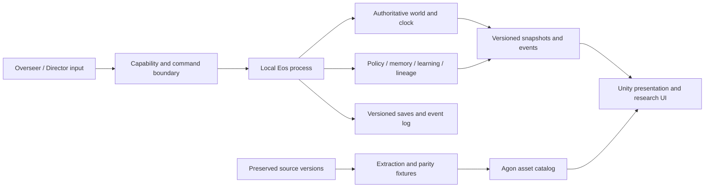

# Architecture and decision record

These are scoped decisions for this repository, not a claim that every game uses
one universal industry-standard stack. Confirmed product choices are distinguished
from proposed implementation details in the migration plan.

## Ownership and dependencies

Unity does not tick hunger, make survival decisions, award technology, or alter a
region in parallel with Eos. Its interpolation is visual only. All player mutations
cross the same validated boundary. The two UI modes never start two simulations.

## Target repository organization

| Area | State | Responsibility |
| --- | --- | --- |
| `src/`, `pack/`, `bin/`, `tests/`, `unity/`, `research/` | Existing, preserved | Baselines and original evidence; no feature development here |
| `unity-game/` | Existing, writable | Shipping Unity client and its tests |
| `bridge/` | Existing, writable | Python process boundary, persistence and parity tools |
| `simulation/` | Planned in M1/M4 | Writable canonical Eos runtime, extracted orchestration and runtime tests; package origin manifest pins source |
| `asset-library/` | Added | Editable/source-derived assets, catalog, generation recipes and visual gallery |
| `tools/assets/` | Added | Offline asset extraction and deterministic validation |
| `tools/repository/` | Added | Repository, graph and Unity metadata checks |
| `docs/migration/` | Added | Decisions, feature matrix, milestones, validation |
| `workspace/` | Existing/extended | Source pins, task dependency graph, build wrappers |
| `node_modules/.cache/` | Ignored local storage | Private runs, historical engines, verification artifacts; replace with documented user cache in packaged app |

Do not copy the complete original Unity scaffold into a new layout again. Refactor
the development project incrementally, retaining GUIDs and checking references.
Create a new module only when it has real code and tests; the table below is a
target, not a claim of implemented assemblies.

| Target client module | Depends on | Owns |
| --- | --- | --- |
| Contracts | No Unity rendering or Python APIs | Immutable DTOs, IDs, versions, units, commands |
| EosTransport | Contracts | Process lifetime, asynchronous I/O, bounded diagnostics, timeouts |
| Presentation | Contracts, content catalog | Terrain, pawns, fauna, weather, interpolation |
| UserInterface | Contracts, presentation services | UI Toolkit views, selection, camera commands, research screens |
| Application | Above modules | Startup, policy pack selection, mode state, save flow |
| Editor | Development modules only | Importers, build entry points, content validation |
| Tests | Specific modules under test | EditMode, PlayMode, packaged integration fixtures |

Use assembly definitions to enforce dependencies; do not merely name folders as
layers. Unity documents their dependency and compilation benefits in its
[assembly organization guide](https://docs.unity.com/en-us/engine/6000.6/manual/programming-environment/script-compilation/assembly-definition-files).

## Decisions and consequences

| Decision | Reason | Consequence / revisit condition |
| --- | --- | --- |
| Keep JAX authoritative for the first release | Preserves exact learned observations, masks, recurrent state and research mechanics | Desktop child process required; a C#/ONNX rewrite needs independent numerical/behavioral parity and is a separate project |
| Keep Unity 6000.6.5f1 pinned for now | This version has actually compiled and run the integration | Evaluate an LTS migration in an isolated branch only if deployment/support needs justify it; no automatic upgrade during gameplay migration |
| Retain existing UI Toolkit foundation | Colony inspectors, lists and overlays fit the current implementation | Complete scrolling, focus, scaling and input tests; use uGUI only for a demonstrated requirement, not a duplicate HUD |
| Agon HTML/SVG is the visual authority | Explicit user choice and existing coherent palettes/characters | Extract assets, do not replace style with unrelated third-party tiles |
| Keep historical source as policy compatibility packages | Saved populations and learned semantics differ from current source | Source fingerprints and policy manifests gate loading; no silent genotype defaults |
| Move toward a writable canonical runtime | Preserved `research/` cannot be the development location for new construction/modes | Versioned changes, upstream comparison and new training/evaluation are required |
| Separate autonomous and intervened provenance | Director actions affect behavior and scientific interpretation | Run history carries an intervention ledger; returning to Overseer cannot remove it |
| Versioned saves, not browser-save coercion | Models differ in calendar, state, skills, identity and policy memory | Browser saves remain readable in the reference game; any future importer is opt-in and lists loss explicitly |
| Use local asset loading first; plan Addressables before large content sets | Bootstrap has little content; world catalogs need managed lifetimes | Install a version compatible with the pinned Editor when M3 content groups exist; test a clean offline content build |
| Keep simulation/research dependencies out of art extraction | `art.js` mixes rendering and game rules | Export allowlisted shapes and palettes; do not copy its AI/genetics/economy into Unity |

Unity's [asset workflow](https://docs.unity.com/en-us/engine/6000.6/manual/assets-and-media/asset-workflow)
describes Addressables as its recommended organization system. The migration uses
that direction without installing unused packages or treating remote delivery as
mandatory. Local catalogs must work offline.

## Contract v2 requirements

`hello` negotiates protocol versions, engine fingerprint, observation/action schemas,
policy architecture/hash, available modes, supported commands and units. Snapshots
carry world ID, run ID, sequence, tick, calendar parameters and schema version.
Keep visual appearance IDs distinct from biological genotype fields.

A person is identified by `(world-lineage ID, birth event ID)`, not a reused agent
slot. Events carry tick, stable actor/target IDs, event type, causal references,
source (agent/environment/player), and payload version. Register material, terrain,
species and action names explicitly; C# enum ordering must not infer Python IDs.

Commands include command ID, expected world revision and mode capability. Handle
repeated IDs idempotently, reject stale mutations, apply atomically at tick boundaries,
and return receipts with the resulting revision. Snapshot reads must remain available
after a rejected command. The protocol should not accept arbitrary executable paths
or pickle payloads from in-game messages.

Use dense snapshots until profiling demonstrates a bottleneck. Then add bounded,
versioned delta frames with periodic full snapshots and resynchronization. Preserve
backpressure: no unbounded output queue when the user accelerates time.

## Policy, save and learning boundaries

A policy pack manifest must identify source commit/fingerprint, dependencies,
complete EnvConfig, observation/action schemas, network architecture, population
schema, weights hash, training history and supported execution modes. Validate it
before deserializing trusted legacy populations. Distribution format should migrate
legacy pickle population metadata to a documented array/data format.

Current saves include state, PRNG, recurrent carry and fixed parameters. M4 expands
this to optimizer state, pending trajectories, sleep/consolidation reservoir,
innate policy, inheritance RNG and scheduling. Save operations are atomic; failed
loads never partially mutate the live session. Save migrations always write a new
version and retain the prior file. Policy errors never trigger random fallback.

An intervention fork retains the prior save and records both parent run and command.
New worlds with old weights are evaluations, not restored historical training runs.
Historical trained inference can ship as a compatibility mode only after its
limitations are stated; it is not proof that newly added building actions are learned.

## Repository conventions

- Unity already uses Force Text serialization and Visible Meta Files. Keep both.
- Commit `.meta`, `Packages/manifest.json`, `packages-lock.json` and ProjectSettings;
  ignore Library, Temp, Logs, Builds and local policy artifacts.
- Preserve each GUID when moving assets. Unity describes their role in
  [asset metadata](https://docs.unity.com/en-us/engine/6000.6/manual/assets-and-media/asset-database/contents).
- Use source-based imports with explicit presets, stable semantic IDs and atlases.
  Large editable art/audio sources use scoped LFS patterns; no blanket history rewrite.
- No multiplayer, cloud backend, paid asset dependency or DOTS conversion is assumed.
  Add complexity only when a measured product requirement warrants it.
